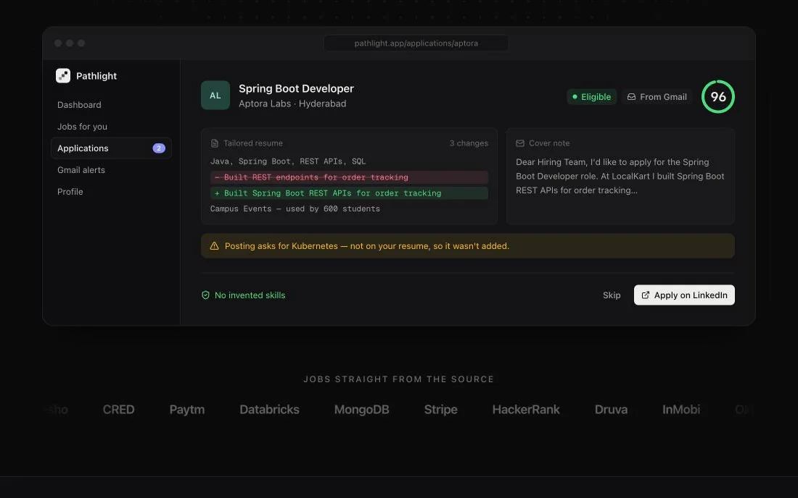

# Pathlight

**Autonomous career and opportunity intelligence for students.** Solo capstone project.

**Live:** [pathlight-iota.vercel.app](https://pathlight-iota.vercel.app) · **API:** FastAPI on Render · **DB:** MongoDB Atlas



Pathlight watches a student's professional picture (resumes, placement emails, skills, deadlines) and on its own surfaces ranked opportunities, eligibility verdicts, skill gaps, preparation plans and tailored resumes. It is an event-driven agentic system with MCP tool access at its core, not a chatbot and not a resume grader.

It never applies on its own: every application is sent **only after the student reviews the tailored resume and approves it**.

## What it does

- **Sources openings** from job boards and from placement emails in Gmail, and extracts structured fields (company, role, CGPA cutoff, allowed branches, deadline, skills).
- **Checks eligibility** with deterministic rules first (CGPA, branch, experience) and calls the LLM only for qualitative criteria a rule can't decide.
- **Finds skill gaps** by matching the posting's skills against the student's resume with embedding search, plus public GitHub repos as extra evidence.
- **Plans preparation** in prerequisite order and creates reminders before deadlines.
- **Tailors the resume** to each posting without inventing skills. This is enforced in code, not just in the prompt: if the tailored text claims a posting skill the base resume doesn't have, the attempt is rejected and retried, and the agent fails rather than return a fabricated resume.

## Architecture

```
job boards / Gmail / pasted JD
        │
        ▼
 LangGraph pipeline ─────────────────────────────────────────────────────────────┐
  discovery → persist → eligibility → skill_gap → planner → resume_tailor → END   │
      └─(extraction failed)→ needs_human_review → END                     │
        │                                                                          │
        ├── MCP servers: Gmail · GitHub (read-only) · filesystem (sandboxed) · reminders
        ├── ChromaDB: resume chunks + embeddings for skill matching (RAG)
        └── LLM client: student's own keys first, then shared Gemini keys (fallback chain)
        │
        ▼
 FastAPI + MongoDB (Beanie) ── JWT auth ── Next.js dashboard
```

| Part | Implementation |
|---|---|
| Agents | 5 LangGraph agents: Discovery, Eligibility, Skill Gap, Planner, Resume Tailor (`backend/app/agents/`, `backend/app/graphs/`) |
| Tools | 4 MCP servers: Gmail, GitHub, filesystem, reminders (`backend/app/mcp/`) |
| Retrieval | Resume chunking → embeddings → ChromaDB (`backend/app/retrieval/`) |
| LLM access | One client, one fallback chain: the student's own keys (Gemini, Groq, OpenAI, Anthropic or any OpenAI-compatible API) first, then the server's Gemini keys, strong model before small. Quota errors, overloads and bad keys fall through to the next link (`backend/app/agents/llm_client.py`) |
| Backend | FastAPI, MongoDB via Beanie, JWT auth, Docker |
| Frontend | Next.js, TypeScript |
| Deployment | Vercel (frontend), Render (backend, Docker), MongoDB Atlas, GitHub Actions cron for Gmail polling |

## Evaluation

A labeled benchmark harness lives in `backend/eval/`. Latest run ([full report](backend/eval/report.md)):

| Agent | Result |
|---|---|
| Discovery (extraction) | 100% accuracy on company, role, compensation, CGPA cutoff and deadline; required-skills F1 0.94 |
| Eligibility | 87.5% accuracy, **0 false positives** (it never claims eligibility it can't support) |
| Skill Gap (retrieval) | Match threshold retuned from 0.34 to 0.38 based on the harness's precision/recall sweep |

The benchmarks are small (18 discovery items, 16 eligibility cases) and are being expanded.

## Tests

- **Backend:** 222 pytest tests, with a fake LLM injected so tests never call a real model.
- **Frontend:** 65 Vitest + React Testing Library tests.
- In production mode the backend **refuses to start** with a weak JWT secret, a localhost database, or Gmail configured without token encryption (`backend/app/core/config.py`).

## Run locally

```bash
cp .env.example .env      # fill in GOOGLE_API_KEY, JWT_SECRET, MONGO_URI, ...
docker compose -f infra/docker/docker-compose.yml up
```

Backend tests: `cd backend && pytest`. Frontend tests: `cd frontend && npm test`.

## Documentation

| Doc | Purpose |
|---|---|
| [docs/ARCHITECTURE.md](docs/ARCHITECTURE.md) | System architecture and what was built at each gate |
| [docs/AI_DESIGN.md](docs/AI_DESIGN.md) | Agents, LangGraph state graph, MCP tools, model routing |
| [docs/AUTONOMOUS_APPLICATIONS.md](docs/AUTONOMOUS_APPLICATIONS.md) | Sourcing, tailoring and human-approved applying |
| [docs/EVALUATION.md](docs/EVALUATION.md) | Benchmark datasets and metrics |
| [docs/API.md](docs/API.md) | REST API |
| [docs/DATABASE.md](docs/DATABASE.md) | Schema and entities |
| [docs/SECURITY.md](docs/SECURITY.md) | Auth, secrets, privacy |
| [docs/DEPLOYMENT.md](docs/DEPLOYMENT.md) | Free-tier deployment and its trade-offs |

## Status

Built in sequential gates (`docs/ARCHITECTURE.md` §8). Gates 0–11 are done: backend, ingestion, AI pipeline, RAG, LangGraph workflow, dashboard, testing and evaluation, autonomous applications (email-apply phase) and cloud deployment. Next: security and observability (Gate 12), then the final demonstration.
